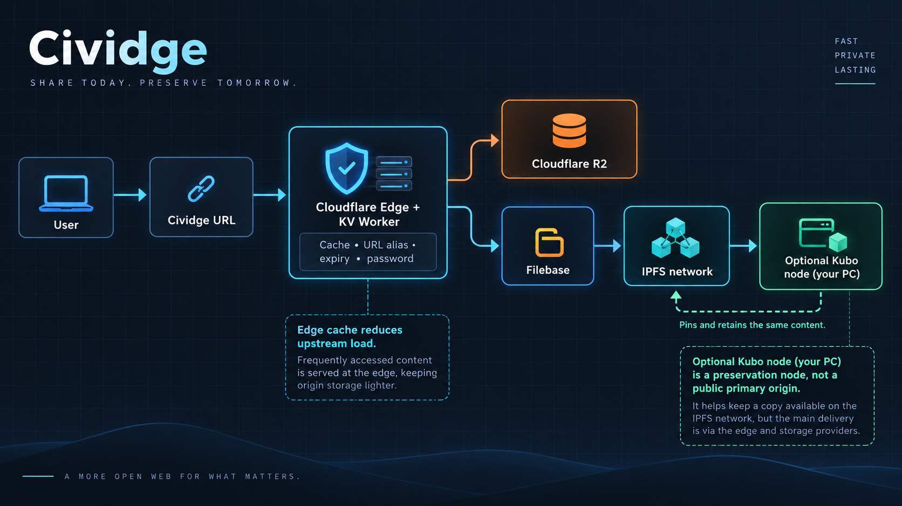

# Civitai Bridge (Cividge)

**A personal, self-managed media uploader for ComfyUI and Civitai users.** Cividge lets you convert media in the browser, publish it under your own delivery domains, and manage the storage credentials and lifecycle yourself.

It converts media locally in the browser, uploads directly to your own Cloudflare R2 or Filebase bucket, and places a small Cloudflare edge control plane in front of the object. There is no central Cividge upload server.



## Why Cividge

AI creators need more than a temporary file host: they need stable links for Civitai posts, image boards, prompts, workflows, and personal archives. Cividge separates the parts that should remain yours:

- **Browser:** local conversion and direct S3 API upload.
- **Storage:** a Cloudflare R2 bucket or Filebase IPFS bucket in your own account.
- **Delivery:** readable URLs in the form `delivery-domain/file-name`.
- **Control plane:** LinkBinding owns canonical Link bindings; ObjectLifecycle owns Object membership and Placement release. Workers KV is the delivery/configuration projection, not lifecycle authority.
- **Preservation:** Filebase/IPFS and an optional Kubo node can keep content reachable after Filebase capacity is released.

This is not a promise of permanent storage. It is a practical, user-controlled design that avoids dependence on one application server and makes the storage lifecycle explicit.

Managed Object identity is `sha256:<digest>` of the exact final uploaded bytes.
R2 keys and Filebase/Kubo CIDs are Placement locators, not Object identities;
equal bytes stored in several providers share one ObjectLifecycle authority.
All Links to the same Object are peers: changing a filename with the pencil
creates another Link; it does not rename or remove the old one.

The lifecycle properties that Cividge must preserve are defined in
[SPEC.md](SPEC.md). It is the contract for links, shared CID cleanup, expiry,
password gates, retries, and Kubo preservation.

## Features

- Browser-side passthrough, WebP, JPEG, and JPEG XL conversion, plus metadata and workflow inspection. The conversion and filename checkboxes are UI controls; persisted meanings are `conversionMode` and `filenamePolicy` (`{original}` means no rename).
- Direct S3-compatible upload to Cloudflare R2 or Filebase IPFS.
- Per-storage delivery domains and peer Links, including the pencil action's same-host Link creation, with `delivery-domain/file-name` URLs.
- Cloudflare edge delivery with KV-backed resolution, expiry, password gates, Open Graph responses, byte ranges, and cache control.
- Final-byte identity preflight: the same bytes can gain another peer Link without a duplicate physical upload; the same Link bound to different bytes conflicts before physical PUT.
- Separate FIFO capacity controls for R2 and Filebase.
- Optional Kubo pin preservation before Filebase releases an object.
- Video previews are R2 auxiliary bytes owned by the parent ObjectLifecycle, not independent public Links.
- One canonical browser-managed snapshot with **All / R2 / Filebase** filters. On the same origin, the last observed list survives reload as a presentation cache; **Refresh** is the explicit current-state observation. Image previews use the original public URL; video previews use an ObjectId-keyed browser Cache Storage and can be restored without a managed Refresh.
- Public cache policies: **BOARD** favors deletion response; **PUBLISHED** explicitly allows up to seven days at the edge when a managed origin exists. Browser freshness remains shorter, and Link expiry always caps freshness.
- Optional Windows **Send To** integration and external upload API.
- One global per-file upload limit: **80 MB (80,000,000 bytes)**, checked on the original and final media bytes by the browser and on received bytes by the Worker API.
- `X-Image-Width` and `X-Image-Height` response headers for newly uploaded images.

## Architecture

| Layer | Responsibility |
| --- | --- |
| Cividge Pages | Browser UI, local conversion, direct R2 / Filebase S3 upload, local presentation cache; no direct KV binding or lifecycle authority |
| LinkBinding Durable Object | Canonical `host:filename` uniqueness, binding, generation, and Link-level policy |
| ObjectLifecycle Durable Object | Immutable Object membership, Placement state, and physical-release authorization |
| Workers KV (`CIVIDGE_KV`) | Public delivery projection and runtime GatewayConfig; disposable, not an authority |
| Delivery/management Worker | Authenticated control-plane API, one-KV-lookup public delivery, and authorized Worker-side actuators |
| Cloudflare Edge | Caching, Open Graph responses, and traffic absorption |
| Cloudflare R2 | Conventional object storage |
| Filebase / IPFS | CID-based IPFS storage and retrieval |
| Kubo (optional) | A self-managed node that pins CIDs before Filebase capacity release |

Kubo is a preservation layer. Its RPC endpoint is used for pin operations; configuring Kubo alone does not make it the public primary origin for every request. Keep important media in another backup as well.

## Prerequisites

- For normal use, open the hosted frontend at [cividge.pages.dev](https://cividge.pages.dev/). A separate frontend deployment is optional.
- For deploying your own Worker or frontend: Git and Node.js 22.12+ (22.x) or 24.x. The current Vite build does not support Node.js 18.
- A Cloudflare account
- Wrangler (`npx wrangler` is sufficient)
- A Cloudflare R2 bucket and/or a Filebase IPFS bucket

## Setup overview

The frontend repository (`cividge`) and the delivery/registry Worker repository (`cividge-kv-worker`) work together.

1. Create one Cloudflare Workers KV namespace for the **Worker** and configure its `CIVIDGE_KV` binding, Durable Object bindings/migrations, and any R2 binding required by your deployment.
2. Deploy `cividge-kv-worker` with a private admin token. Wrangler applies its declared Durable Object migrations; do not treat KV as their replacement.
3. Open the existing [Cividge frontend](https://cividge.pages.dev/). Deploy a separate frontend only if you want to manage its code and origin yourself.
4. In Cividge, explicitly connect **your own** KV Worker URL and admin token first, then connect R2 and/or Filebase. Shared UI does not mean shared storage or lifecycle authority.
5. Register separate delivery domains for R2 and Filebase.
6. Configure R2 CORS when using browser-to-R2 uploads.

> Do not register the same delivery domain for both R2 and Filebase. URLs are `delivery-domain/file-name`; sharing a domain makes same-name objects ambiguous.

### 🤖 For AI Coding Agents (Codex, Claude, etc.)

This repository includes official agent skills in [`.codex/skills/`](.codex/skills/) to automate safe builds, deployments, and public relay creation without breaking existing routes:

- **`cividge-deploy`**: Safely pulls latest code, enforces `npm run build`, and deploys to Cloudflare Pages or Workers with automated curl health verification.
- **`cloudflare-pages-relay`**: Deploys function-free, disposable `pages.dev` 307 relays and registers them into the multi-relay worker without exposing origin domains.

## 1. Deploy the KV delivery and management Worker

```bash
git clone https://github.com/OKPN/cividge-kv-worker.git
cd cividge-kv-worker
npx wrangler login
```

Create a Workers KV namespace in Cloudflare, then bind it as `CIVIDGE_KV` in the **Worker repository's** `wrangler.toml`:

```toml
[[kv_namespaces]]
binding = "CIVIDGE_KV"
id = "<your-kv-namespace-id>"
```

Keep that repository's `LINK_BINDING` / `OBJECT_LIFECYCLE` Durable Object bindings and migrations. If using its R2 delivery or parent-owned video previews, configure its R2 binding and keep `R2_BUCKET_NAME` equal to the bound bucket name. The [Worker README](https://github.com/OKPN/cividge-kv-worker#readme) documents its remaining secrets and bindings.

Set a long, random admin token and deploy. Never commit this token.

```bash
npx wrangler secret put ADMIN_API_TOKEN
npx wrangler deploy
```

Save the resulting `https://<worker>.<account>.workers.dev` URL. It is the Cividge KV delivery and management Worker URL.

### Optional: external upload API

For Windows **Send To** or curl uploads, use a separate upload-only token:

```bash
npx wrangler secret put UPLOAD_TOKEN
```

If the Worker itself uploads to Filebase, also provide a bucket-scoped Filebase IPFS RPC API key:

```bash
npx wrangler secret put FILEBASE_IPFS_API_KEY
```

Worker-managed Filebase RPC acquisition and physical `pin/rm` additionally require `FILEBASE_DEDICATED_BUCKET = "true"` in the **Worker** configuration. Enable it only for a Cividge Worker RPC-dedicated bucket/token: do not mix browser S3 uploads or external pins into that bucket. The default is `false`; browser S3 credentials remain in the browser. The Worker may unpin only a recorded Worker-managed RPC Placement after ObjectLifecycle authorizes release.

Do not reuse `ADMIN_API_TOKEN` in batch files or external upload clients.

## 2. Optional: deploy your own Cividge frontend

Skip this section when using [cividge.pages.dev](https://cividge.pages.dev/). For browser uploads, allow that origin in your provider CORS. External upload clients should use your own Worker's upload API; the hosted Pages `/api/upload` proxy is configured for its maintainer's Worker, not automatically for every user's Worker.

```bash
git clone https://github.com/OKPN/cividge.git
cd cividge
npm install
npx wrangler login
```

Configure this repository's `wrangler.toml` with the canonical Worker URL for the Pages upload proxy:

```toml
[vars]
CIVIDGE_KV_WORKER_URL = "https://<worker>.<account>.workers.dev"
```

The Pages project has **no `CIVIDGE_KV` binding**. Public media delivery and lifecycle mutations go through the Worker; Pages is the frontend and upload proxy.

Build and deploy:

```bash
npm run build
npx wrangler pages deploy dist --project-name=my-cividge
```

The resulting `https://my-cividge.pages.dev` URL is your frontend URL. Use it as an allowed origin in R2 CORS; it is not necessarily a delivery domain.

For a local production-like check:

```bash
npm run preview
```

## 3. Connect services in Cividge

Open [cividge.pages.dev](https://cividge.pages.dev/) or your own Pages deployment and configure services in this order:

1. **KV Delivery & Management Worker** — enter its URL and `ADMIN_API_TOKEN`, then connect.
2. **Cloudflare R2** and/or **Filebase (IPFS)** — enter each storage provider's credentials and connect.
3. Register one or more dedicated delivery domains for each provider.

The Worker's `workers.dev` URL can be used for the management API. Current delivery code rejects public media GET on `workers.dev`; use a Worker custom domain for delivery, optionally fronted by a static Pages relay. The selected public hostname must match the relay identity and allowlist entry.

### Everyday use

1. Choose the final output (`no conversion`, WebP, JPEG XL, or JPEG) and a filename rule. Turning the filename checkbox off stores `{original}`; the pencil action in the managed list creates another same-host peer Link rather than renaming the Object.
2. Choose **BOARD** for shorter-lived public caching or **PUBLISHED** only when you accept a longer edge cache (subject to managed-origin and Link-expiry caps). Upload to R2 or Filebase; the final bytes determine ObjectId before physical mutation.
3. The **All / R2 / Filebase** tabs filter one managed snapshot. Returning to the same browser shows the last locally observed rows without network I/O; those rows may be stale. Press **Refresh** for a new observation. A refresh failure does not mean the file count is zero.
4. A video row shows its parent-owned thumbnail from the browser's ObjectId-keyed preview cache when available. Image rows use their original public image URLs. Neither preview requires a managed-list Refresh; preview failure leaves the row visible.

The **IPFS Public Gateway** controls are an administrator UI for the delivery Worker's GatewayConfig, not a browser-only CID viewer. Saving them calls the authenticated Worker API and stores `config:ipfs_gateways` in the Worker's KV. Gateway failure changes only retrieval routing, not Object or Placement lifecycle.

## Cloudflare R2

Create an R2 bucket and an S3 API token, then enter:

- Cloudflare Account ID
- R2 bucket name
- Access Key ID
- Secret Access Key

### R2 CORS is required for browser uploads

Cividge calls R2's S3 API directly from the browser. In Cloudflare Dashboard, open **R2 → your bucket → Settings → CORS Policy → Edit**, then paste the policy generated by Cividge's **Copy CORS policy** button.

Allow the URL where the frontend is opened, such as `https://my-cividge.pages.dev`; do not use the media delivery domain as the CORS origin.

```json
[
  {
    "AllowedOrigins": [
      "https://my-cividge.pages.dev",
      "http://127.0.0.1:5173",
      "http://localhost:5173"
    ],
    "AllowedMethods": ["GET", "HEAD", "PUT", "POST", "DELETE"],
    "AllowedHeaders": ["*"],
    "ExposeHeaders": ["ETag", "Content-Length", "Content-Type"],
    "MaxAgeSeconds": 3600
  }
]
```

## Filebase / IPFS

Create an IPFS bucket and S3 access keys in Filebase, then enter:

- Filebase bucket name
- Filebase Access Key
- Filebase Secret Key
- A Filebase-only delivery domain

After connecting, run **Configure CORS** once so the bucket permits the required browser-side CID lookup.

When the authoritative preflight finds the same final bytes already placed in Filebase, it can add another peer Link without re-uploading the bytes. A reused filename with different bytes is a conflict, not an overwrite. If the Link/Object still exists but its Filebase Placement is absent, upload reacquires that Placement instead of creating another Link.

### Create a Filebase delivery URL

Use a Worker-backed Filebase delivery host separate from R2. If you want a distinct `pages.dev` public entry, use the function-free relay below and register that host in the Worker's `STATIC_RELAY_PUBLIC_HOSTS`. Deploying this repository's frontend `dist/` under another Pages project name does **not** by itself create a Filebase delivery origin.

### Stable public `pages.dev` URLs for Filebase

If you want a board-facing `pages.dev/file-name.ext` URL while keeping a
separate Filebase compatibility Worker/domain behind it, deploy the
function-free template in [`compatibility-layer/filebase`](compatibility-layer/filebase/).
Add the resulting public Pages URL to the **Filebase delivery-domain** list and
select it. There is no per-upload switch: the selected delivery domain is always
the public URL Cividge copies and posts.

The relay has no Functions, KV access, or storage credentials. It forwards
`/filename` to the Worker's stable `/r/<relay-id>/filename` namespace. The
selected public host, relay ID, and `STATIC_RELAY_PUBLIC_HOSTS` entry must
identify the same host; use Cividge's connection test before publishing.
Do not flatten `/r/` or redirect to a different registered relay just to pass
the test. If you configure query rewriting or caching on the backend, preserve
the distinction between the original media and `?preview=1` (see the
[cache runbook](docs/SECURITY_AND_CACHE_RUNBOOK.md)).

For R2, the [`compatibility-layer/r2`](compatibility-layer/r2/) template is a
**direct bucket-origin relay**, not a substitute for the Cividge delivery
Worker. Direct bucket URLs bypass Worker-owned Link expiry, password gates,
`?preview=1`, and lifecycle-aware delivery. Use a Worker-backed public host
when those Cividge behaviors are required.

## Optional: use Kubo as a preservation node

Install and start Kubo, then normally set its RPC URL to `http://127.0.0.1:5001`. Enable automatic Kubo pinning only after the connection test succeeds.

- When automatic Kubo pinning is enabled but Kubo is unavailable, Filebase FIFO safely pauses rather than releasing objects without preservation.
- Check Kubo's storage path and available space. Keep important data in another backup or pinning service.
- Do not expose the Kubo API through `0.0.0.0:5001`, router port forwarding, or a public reverse proxy.
- For remote use, prefer a Tailnet-only HTTPS endpoint such as Tailscale Serve instead of opening ports to the internet.

## Delivery, expiry, and deletion behavior

- Public links use `delivery-domain/file-name`, not CID URLs.
- A locally restored managed row is a **last-observed presentation**, not proof that its Link still exists. Switching All / R2 / Filebase filters does not fetch another KV list. Successful explicit Refresh replaces the snapshot (including with zero rows); a failed Refresh keeps the previous view. Acknowledged delete or TTL changes update the local view/cache and cannot be rolled back by an older response.
- A generated video preview is stored once per parent ObjectId in Worker R2 (including when the video itself is on Filebase) and served through the parent Link's `?preview=1` representation. It never gets its own LinkBinding or public KV Link, so the managed list contains only the video row. A real image uploaded with a `.thumb.webp` filename is unaffected. If preview R2 is unavailable, the video remains published and the list shows a placeholder.
- The preview stays while any peer Link remains. After the final Link is removed, the parent ObjectLifecycle authorizes retryable preview cleanup. Preview generation failure does not undo the video upload; the list uses a video placeholder if no preview is available.
- Expiry does not delete storage from a public GET. An expired Link returns 404; lifecycle release is a separate authorized operation. A shared Object remains managed while peer Links still reference it.
- Manual removal and FIFO request the same ObjectLifecycle release authority. A physical R2 delete or Filebase/Kubo unpin is allowed only for the relevant authorized Placement; a browser list entry or KV miss is not a delete oracle.
- `BOARD` and `PUBLISHED` are user-intent cache policies. Published can use up to seven days of public edge freshness when a managed origin exists; no Filebase or Kubo preservation caps it at one day. Browser TTL stays shorter, and no cache freshness may outlive its Link. Worker-to-upstream fetch caching is a separate origin-protection policy.
- For newly uploaded images, delivery responses include `X-Image-Width` and `X-Image-Height` so clients can choose whether to preload a direct image.

### Fresh KV reset / clean semantic cutover

KV is a disposable delivery/configuration projection. If an incompatible pre-release schema need not be retained, switch the **Worker** to a newly created empty namespace rather than copying old keys or adding compatibility reads. This gives a clean baseline: subsequent KV records come from the current Cividge code, making old host, generation, metadata, or Kubo-status ghosts easier to distinguish from current bugs. If ghosts recur after reset, current code or another still-connected producer deserves investigation.

The reset also discards KV-held runtime settings such as `config:ipfs_gateways`; the Worker uses its built-in GatewayConfig until an administrator saves a new one. It does **not** delete Durable Object authority or physical R2, Filebase, or Kubo data. Follow the [Worker's cutover procedure](https://github.com/OKPN/cividge-kv-worker#readme) before changing a production binding.

## Security model and limits

Browser-local credential persistence is an intentional UX requirement: provider keys and the admin token survive reload/restart on the same browser origin. Settings remain portable through explicit encrypted QR/backup export. New exports use AES-GCM with a random 128-bit restoration key displayed separately from the URL; the old plaintext sync URLs and six-digit XOR PIN backups are no longer accepted. Keep the URL and restoration key separately. Clearing browser data can still remove the local settings.

Use a Cividge-bucket-scoped **Object Read & Write** R2 key, rather than an account-wide administrative credential. Filebase's S3 key is account-wide under its current [access-key model](https://filebase.com/docs/concepts/access-keys); a separate Cividge account is needed to isolate unrelated buckets. The app cannot reduce a stolen key's provider permissions by selecting one bucket in the UI.

The frontend CSP permits local bundled scripts and conversion WASM, while blocking inline JavaScript and JavaScript `eval`. Inline CSS remains necessary for the current UI. Credential-bearing endpoint URLs are rejected, and application logs use a redacted diagnostic projection. See the [Browser Secret & XSS Boundary Audit](docs/BROWSER_SECRET_XSS_AUDIT.md) for the persistence inventory, authority/capability boundaries, explicit export behavior, and remaining risks.

- R2/Filebase S3 credentials and the admin token are browser-local settings. Use only a device and a Pages URL you trust; rotate any weak or exposed token. Browser-held Filebase credentials can directly mutate their bucket outside Cividge's lifecycle checks, so keep that trust boundary explicit.
- `ADMIN_API_TOKEN` authorizes management mutations. `UPLOAD_TOKEN` / `TEST_UPLOAD_TOKEN` are separate upload-only capabilities; a test token is **not** a separate environment unless it points at separate Worker/storage resources.
- Password protection protects Cividge delivery URLs. It does **not** make a known IPFS CID secret from an IPFS gateway. Strong confidentiality requires client-side encryption, which is not currently part of Cividge.
- Keep `UPLOAD_TOKEN` separate from the admin token and do not distribute upload batch files casually.
- This project improves resilience; it is not a substitute for backups or a promise of permanent availability.

## Development

```bash
npm install
npm run build
npm run preview
```

## Documentation and Guides

- [Storage Selection & Operations Guide](docs/STORAGE_SELECTION_GUIDE.md) — placement choices, preservation limits, and current-provider pricing links.
- [Security & Cache Runbook](docs/SECURITY_AND_CACHE_RUNBOOK.md) — cache/route boundaries, including media versus `?preview=1`.
- [Standalone R2 + Pages Example](docs/FREE_R2_PAGES_CDN_GUIDE.md) — historical independent proxy example; **not** Cividge's current delivery architecture.
- [System Invariants (INVARIANTS.md)](INVARIANTS.md) — Non-negotiable system rules and design constraints.
- [Specification (SPEC.md)](SPEC.md) — Core lifecycle contracts.

## Related repository

- [cividge-kv-worker](https://github.com/OKPN/cividge-kv-worker) — KV registry, delivery, and cache management Worker

## License

MIT License © 2026 OKPN

